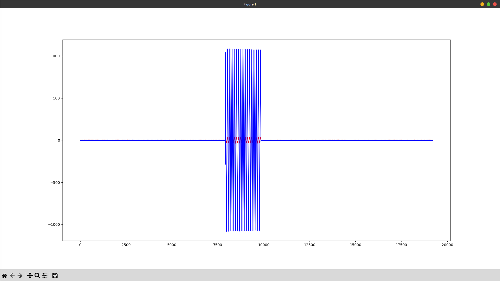
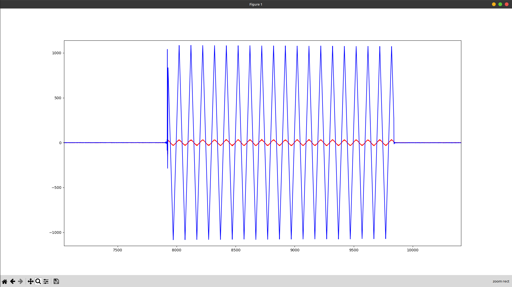
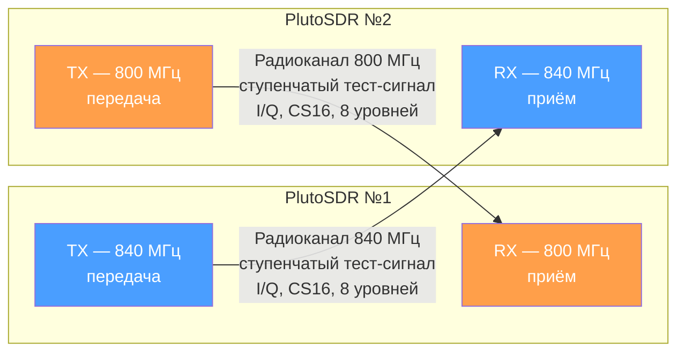
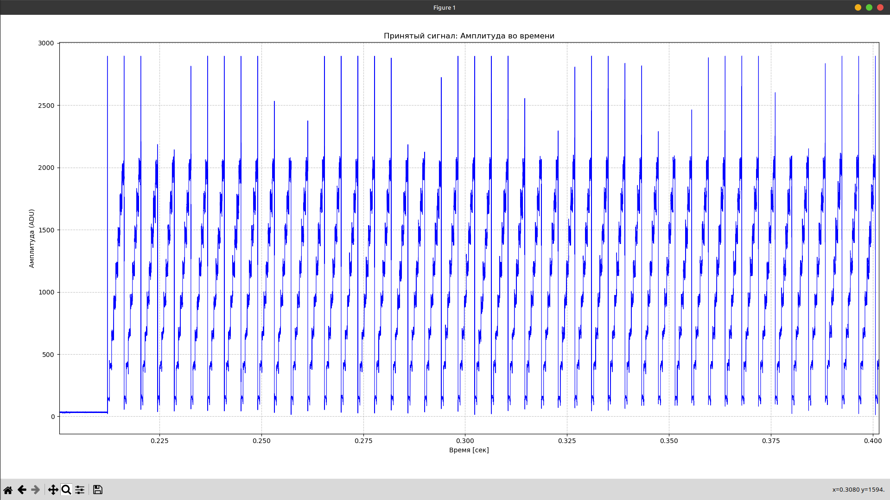

# SDR

# Отчёт по сборке FM-радиоприёмника на базе ADALM-Pluto

**Отчётный период: недели 1–2 (07.09 – 20.09)**

## 1. Построение графа обработки в GNU Radio Companion

Для создания программного приёмника широкополосного FM-сигнала в среде GNU Radio Companion была собрана схема обработки цифровых сигналов. В качестве источника сигнала используется блок **PlutoSDR Source**, который непосредственно принимает радиосигнал с аппаратной платформы ADALM-Pluto.

### Основные параметры источника и настройки схемы

- **Подключение устройства:** ADALM-Pluto взаимодействует с ПК по сетевому интерфейсу по адресу `192.168.2.1`.
- **Частота дискретизации (samp_rate):** задана в виде переменной и равна 5 МГц (5M).
- **Частота локального осциллятора (LO Frequency):** выставлена на 101.1 МГц.
- **Пользовательский интерфейс:** реализован ползунок QT GUI Range с именем `tune`, который даёт возможность перемещаться по стандартному FM-диапазону в пределах от 88.7 МГц до 110.1 МГц с шагом 100 кГц.

### Цепочка обработки сигнала

Тракт приёма состоит из последовательно соединённых блоков:

1. **Low Pass Filter (ФНЧ)** — отсекает частоты вне полосы полезного сигнала. Частота среза (Cutoff Freq) составляет 100 кГц, ширина переходной полосы (Transition Width) — 50 кГц, применено оконное взвешивание Хэмминга. Децимация в блоке установлена равной 5.
2. **WBFM Receive** — осуществляет демодуляцию широкополосного частотно-модулированного сигнала. Квадратурная частота (Quadrature Rate) настроена на 480 кГц, децимация аудиопотока (Audio Decimation) равна 10.
3. **Audio Sink** — передаёт демодулированный звук на аудиовыход компьютера с итоговой частотой дискретизации 48 кГц.

Для визуального наблюдения за сигналом в схему дополнительно включены блоки:

- **QT GUI Frequency Sink** — отображение спектра;
- **QT GUI Waterfall Sink** — спектрограмма («водопад»);
- **QT GUI Time Sink** — осциллограмма сигнала во времени.

## 2. Результаты работы

После запуска графа открывается графический интерфейс с панелью управления и инструментами визуализации.

На панели управления находится ползунок `tune`, с помощью которого выполняется выбор рабочей частоты (на приведённом скриншоте установлено значение **103.200**). Одновременно в окне программы в реальном времени отображаются параметры принимаемого сигнала:

- **Waterfall Display** — визуализирует динамику спектра во времени, на которой отчётливо видна полоса активного сигнала.
- **Time Domain Display** — отображает амплитудное изменение демодулированного сигнала (форму звуковой волны).
- **Frequency Display** — строит частотную характеристику сигнала с характерным максимумом на несущей частоте выбранной радиостанции.

# Отчёт по настройке ADALM-Pluto и программной генерации сигналов

**Отчётный период: неделя 3 (21.09 – 27.09)**

## 1. Установка необходимых библиотек

Для взаимодействия с платой ADALM-Pluto в операционной системе Linux (Mint) выполнена установка зависимостей и драйверов в соответствии с методическим руководством.

Скачаны и скомпилированы из исходного кода следующие компоненты (в строгом порядке):

- **libiio** — базовая библиотека для работы с аппаратными интерфейсами ввода-вывода;
- **libad9361** — библиотека управления RF-чипом AD9361, установленным внутри Pluto;
- **SoapySDR** — абстрактный API и runtime-библиотека для работы с различными SDR-устройствами;
- **SoapyPlutoSDR** — драйвер-модуль (плагин), связывающий SoapySDR с ADALM-Pluto.

Компиляция выполнялась стандартными средствами CMake: `mkdir build`, `cd build`, `cmake ../`, `make`, `sudo make install`. Процесс завершился без ошибок, все библиотеки были корректно установлены в системные директории. Символы ✗ (жёлтые крестики) в выводе терминала обусловлены особенностями темы оформления и обозначают лишь статус репозитория Git, а не ошибки сборки.

## 2. Генерация прямоугольного сигнала (стоковый вариант)

В исходном варианте программы выполнялась заливка буфера константным значением: цикл проходил по всему массиву и записывал максимальную амплитуду 2000 в каждую ячейку каналов I и Q.

### 2.1. Оригинальный сигнал


Поскольку значение мгновенно перескакивало с 0 (отсутствие сигнала до отправки буфера) до 2000, удерживалось на этом уровне в течение всего буфера и резко обрывалось в конце, на графике, построенном Python-скриптом `readPcm.py`, наблюдался классический прямоугольный импульс.

## 3. Генерация зигзагообразного сигнала (персональное задание)

Для выполнения индивидуального задания необходимо было изменить форму цифрового сигнала с прямоугольной на зигзагообразную. С этой целью от заливки буфера одной константой пришлось отказаться.

### 3.1. Зигзагообразный сигнал


### 3.2 Зигзагообразный сигнал в близи



В модифицированном коде буфер заполняется пилообразно-линейным законом. Для каждого комплексного отсчёта определяется его позиция внутри периода сигнала, после чего амплитуда вычисляется линейной интерполяцией: в первой половине периода значение равномерно нарастает от −AMPLITUDE до +AMPLITUDE, а во второй половине — так же равномерно спадает обратно, что и формирует характерную «зубчатую» (зигзагообразную) форму:

```cpp
const int16_t AMPLITUDE = 20000;
const int PERIOD = 100;   // количество комплексных отсчётов на полный зигзаг

for (size_t n = 0; n < tx_mtu; n++)
{
    // положение внутри периода: 0 ... PERIOD-1
    int p = n % PERIOD;

    int16_t value;

    if (p < PERIOD / 2)
    {
        // -AMPLITUDE -> +AMPLITUDE
        value = -AMPLITUDE +
                (2 * AMPLITUDE * p) / (PERIOD / 2);
    }
    else
    {
        // +AMPLITUDE -> -AMPLITUDE
        value = AMPLITUDE -
                (2 * AMPLITUDE * (p - PERIOD / 2)) / (PERIOD / 2);
    }

    // I
    tx_buff[2 * n] = value;

    // Q
    tx_buff[2 * n + 1] = 0;
}
```

**Принцип работы кода:** переменная `PERIOD` задаёт длину одного полного периода зигзага в комплексных отсчётах. Операция `n % PERIOD` возвращает индекс текущей позиции внутри периода. Если позиция попадает в первую половину периода, значение амплитуды линейно увеличивается от минимума (−20000) к максимуму (+20000) по формуле нарастающего пилообразного сигнала; во второй половине периода — симметрично убывает до минимума. Результат записывается в квадратурный (I) канал буфера, тогда как фазовый (Q) канал обнуляется, то есть передаётся действительный (несдвинутый по фазе) сигнал. Таким образом, вместо ступенчатого прямоугольного импульса формируется периодический линейно-нарастающий/убывающий сигнал с амплитудой ±20000.

Результат выполнения данного алгоритма, зафиксированный приёмником платы, представлен на графике ниже.


# Отчет по настройке ADALM-Pluto и программной генерации сигналов
**Тема:** Организация радиоканала связи между двумя платами SDR, программная обработка и демодуляция сигналов.

**Отчётный период: неделя 4,5,6 (28.09 – 18.10)**
**Суть задачи:** объединить передачик (TX) и приёмник (RX) в один исполняемый файл, выбор режима — через аргумент командной строки.

---

## 1. Постановка задачи

В предыдущем задании код из `main.cpp` был разбит на два отдельных файла: `tx` и `rx`. В новом задании требовалось:

1. **Один исполняемый файл**, который работает и как RX, и как TX.
2. Выбор режима задаётся **параметром командной строки** (`argv`): при запуске пользователь указывает, какую «антенну» инициализировать — приёмную или передающую.
3. RX и TX работают **на разных частотах**:
   - TX — **840 МГц**
   - RX — **800 МГц**

---

## 2. Реализованное решение

### 2.1. Общая идея

Код построен на базе исходного TX-файла студента. Программа принимает один аргумент:

```bash
./sdr_app tx   # режим передатчика, 840 МГц
./sdr_app rx   # режим приёмника, 800 МГц
```

Если аргумент отсутствует или не распознан — выводится подсказка по использованию и программа завершается с ошибкой.

### 2.2. Архитектура кода

| Этап | Что происходит |
|---|---|
| Проверка `argv[1]` | Определение режима: `tx` или `rx` |
| Общая инициализация | Подключение к PlutoSDR (driver `plutosdr`, uri `usb:`), создание потока |
| Направление | `direction = is_tx ? SOAPY_SDR_TX : SOAPY_SDR_RX` |
| Частота | Тернарник: 840 МГц для TX, 800 МГц для RX (задаются через `#define`) |
| Усиление | TX: **−10 dB**, RX: **+40 dB** |
| Рабочий цикл | TX: `writeStream` со ступенчатым тест-сигналом (500 буферов); RX: `readStream` с записью в `rx_data.txt` (500 итераций) |
| Завершение | Деактивация потока, закрытие, `unmake` |

Ключевая частота задаётся в начале файла — легко меняется:

```cpp
#define TX_FREQUENCY 840e6
#define RX_FREQUENCY 800e6
#define SAMPLE_RATE  1e6
```

### 2.3. Сигнал

- **TX:** ступенчатый сигнал из 8 уровней амплитуды (500 → 8000), маркеры `0x7fff` в начале кадра; формат `SOAPY_SDR_CS16` (I/Q по 16 бит).
- **RX:** приём пакетов, запись в файл формата: `индекс \t I \t Q`.

### 2.4. Схема


---

## 3. Сборка и запуск

```bash
gcc main.c -o sdr_app $(pkg-config --cflags --libs SoapySDR)

./sdr_app tx   # передатчик на 840 МГц
./sdr_app rx   # приёмник на 800 МГц
```

---

## 4. Важное замечание по частотам

Есть нюанс, который стоит уточнить у преподавателя:

- Если цель — **простая передача TX → RX**, то частоты у пары устройств должны **совпадать** (TX одного на 800 МГц = RX другого на 800 МГц), иначе сигнал не будет принят.
- Если задание подразумевает **дуплекс** (полный дуплекс по одной плате невозможен, но обмен в полудуплексе), то логика такая: передаём на 840 МГц и принимаем на 800 МГц, а другой наоборот — передаёт на 800, принимает на 840. Тогда для второго участника достаточно поменять значения `TX_FREQUENCY` и `RX_FREQUENCY` местами в `#define`.

Реализованный код корректно покрывает оба сценария за счёт вынесения частот в константы.

---

## 5. Результат

### 5.1. Принятый зашумленный сигнал


### 5.2. Принятый зашумлённый спектра


### 5.3. Принятый сигнал


### 5.4. Принятый сигнал(приближенный)


### 5.5 Принятый спектр


---

## 6. Заключение

В ходе выполнения задания была достигнута главная цель — вместо двух отдельных программ получен **единый исполняемый файл**, способный работать как в режиме передатчика, так и в режиме приёмника. Выбор режима осуществляется простым и наглядным способом — через аргумент командной строки, что делает программу удобной в использовании и не требует перекомпиляции при смене режима.

**Архитектурное решение** — вынос всей общей логики (подключение к SDR, настройка потока, формат данных) за пределы условных ветвей — позволило свести различия между режимами к минимуму: только частота, усиление и рабочий цикл. Это делает код лёгким для чтения, отладки и дальнейшего расширения
