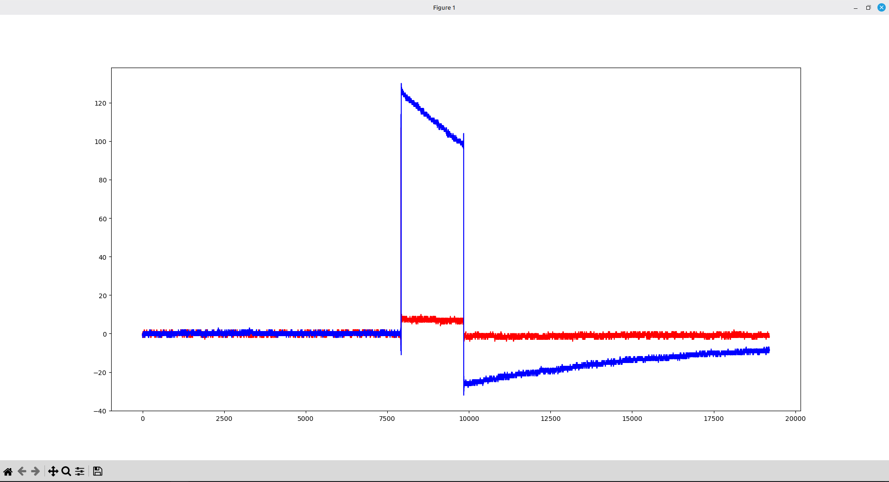

# Отчёт по настройке ADALM-Pluto и программной генерации сигналов

**Отчётный период: неделя 3 (21.09 – 27.09)**

## 1. Установка необходимых библиотек

Для взаимодействия с платой ADALM-Pluto в операционной системе Linux (Mint) выполнена установка зависимостей и драйверов в соответствии с методическим руководством.

Скачаны и скомпилированы из исходного кода следующие компоненты (в строгом порядке):

- **libiio** — базовая библиотека для работы с аппаратными интерфейсами ввода-вывода;
- **libad9361** — библиотека управления RF-чипом AD9361, установленным внутри Pluto;
- **SoapySDR** — абстрактный API и runtime-библиотека для работы с различными SDR-устройствами;
- **SoapyPlutoSDR** — драйвер-модуль (плагин), связывающий SoapySDR с ADALM-Pluto.

Компиляция выполнялась стандартными средствами CMake: `mkdir build`, `cd build`, `cmake ../`, `make`, `sudo make install`. Процесс завершился без ошибок, все библиотеки были корректно установлены в системные директории.

## 2. Генерация прямоугольного сигнала (стоковый вариант)

В исходном варианте программы выполнялась заливка буфера константным значением: цикл проходил по всему массиву и записывал максимальную амплитуду 2000 в каждую ячейку каналов I и Q.

### 2.1. Оригинальный сигнал


Поскольку значение мгновенно перескакивало с 0 (отсутствие сигнала до отправки буфера) до 2000, удерживалось на этом уровне в течение всего буфера и резко обрывалось в конце, на графике, построенном Python-скриптом `plot.py`, наблюдался классический прямоугольный импульс.

## 3. Генерация зигзагообразного сигнала (персональное задание)

Для выполнения индивидуального задания необходимо было изменить форму цифрового сигнала с прямоугольной на зигзагообразную.

### 3.1. Зигзагообразный сигнал


### 3.2 Зигзагообразный сигнал в близи


В модифицированном коде буфер заполняется пилообразно-линейным законом. Для каждого комплексного отсчёта определяется его позиция внутри периода сигнала, после чего амплитуда вычисляется линейной интерполяцией: в первой половине периода значение равномерно нарастает от −AMPLITUDE до +AMPLITUDE, а во второй половине — так же равномерно спадает обратно, что и формирует «зигзагообразную» форму:

```cpp
const int16_t AMPLITUDE = 20000;
const int PERIOD = 100;   // количество комплексных отсчётов на полный зигзаг

for (size_t n = 0; n < tx_mtu; n++)
{
    // положение внутри периода: 0 ... PERIOD-1
    int p = n % PERIOD;

    int16_t value;

    if (p < PERIOD / 2)
    {
        // -AMPLITUDE -> +AMPLITUDE
        value = -AMPLITUDE +
                (2 * AMPLITUDE * p) / (PERIOD / 2);
    }
    else
    {
        // +AMPLITUDE -> -AMPLITUDE
        value = AMPLITUDE -
                (2 * AMPLITUDE * (p - PERIOD / 2)) / (PERIOD / 2);
    }

    // I
    tx_buff[2 * n] = value;

    // Q
    tx_buff[2 * n + 1] = 0;
}
```

**Принцип работы кода:** переменная `PERIOD` задаёт длину одного полного периода зигзага в комплексных отсчётах. Операция `n % PERIOD` возвращает индекс текущей позиции внутри периода. Если позиция попадает в первую половину периода, значение амплитуды линейно увеличивается от минимума (−20000) к максимуму (+20000) по формуле нарастающего пилообразного сигнала; во второй половине периода — симметрично убывает до минимума. Результат записывается в квадратурный (I) канал буфера, тогда как фазовый (Q) канал обнуляется, то есть передаётся действительный (несдвинутый по фазе) сигнал. Таким образом, вместо ступенчатого прямоугольного импульса формируется периодический линейно-нарастающий/убывающий сигнал с амплитудой ±20000.

