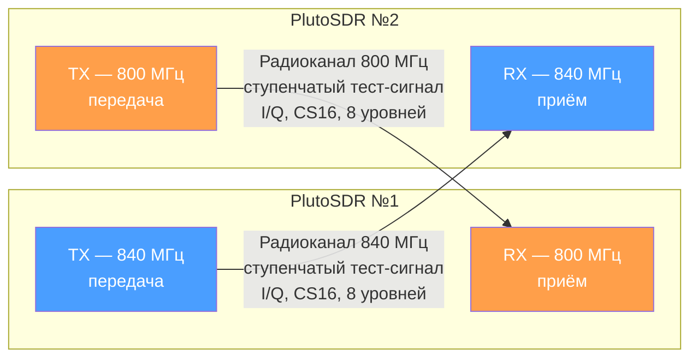
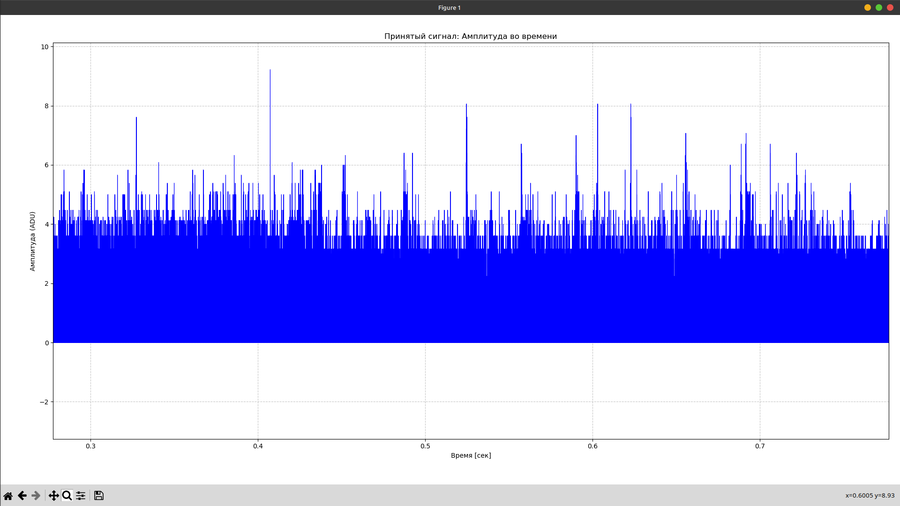
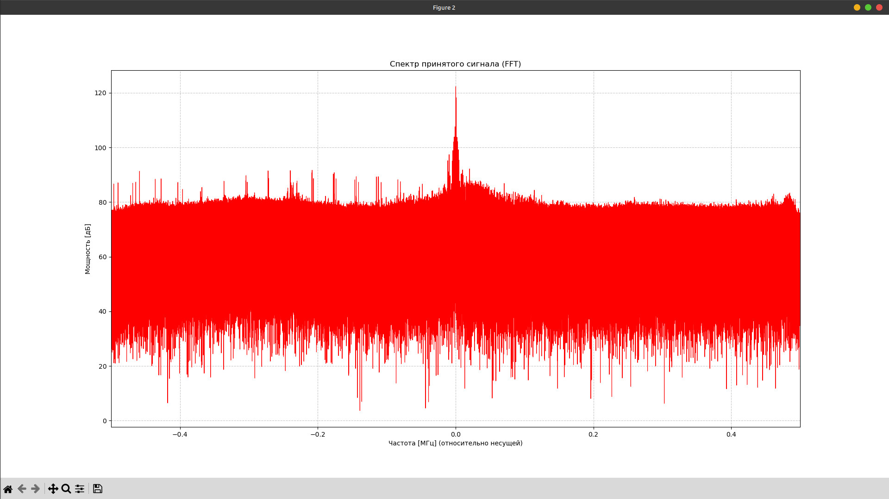
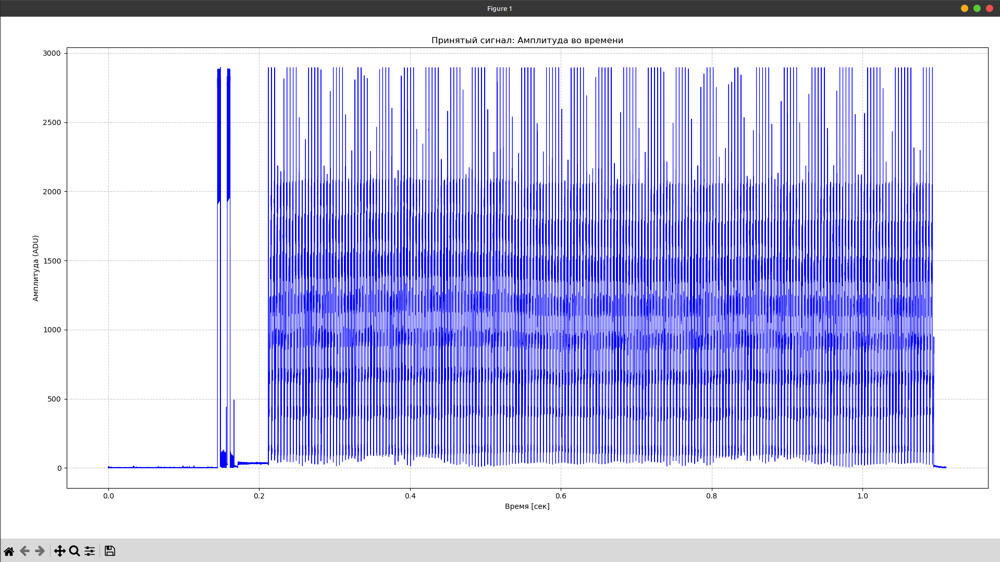
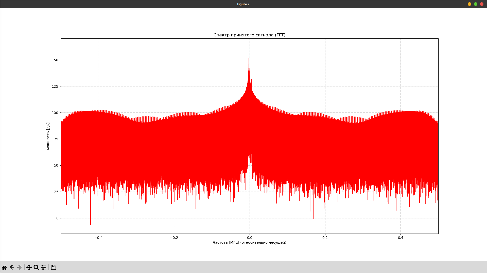

# Отчет по настройке ADALM-Pluto и программной генерации сигналов
**Тема:** Организация радиоканала связи между двумя платами SDR, программная обработка и демодуляция сигналов.

**Отчётный период: неделя 4,5,6 (28.09 – 18.10)**
**Суть задачи:** объединить передачик (TX) и приёмник (RX) в один исполняемый файл, выбор режима — через аргумент командной строки.

---

## 1. Цель работы

Объединить программы передатчика (TX) и приёмника (RX) в один исполняемый файл. Передача выполняется на частоте 840 МГц, приём — на частоте 800 МГц.

## 2. Реализованное решение

В зависимости от переданного аргумента пргограмма запускается в режиме TX или RX.

```cpp
#define TX_FREQUENCY 840e6
#define RX_FREQUENCY 800e6
#define SAMPLE_RATE  1e6
```

Выбор режима выполняется в начале программы:

```cpp
// Проверка аргумента командной строки
    if (argc < 2)
    {
        printf("Usage: %s rx\n", argv[0]);
        printf("  tx - передатчик (%.0f MHz)\n", TX_FREQUENCY / 1e6);
        printf("  rx - приёмник   (%.0f MHz)\n", RX_FREQUENCY / 1e6);
        return EXIT_FAILURE;
    }

    int is_tx;
    if (strcmp(argv[1], "tx") == 0)
    {
        is_tx = 1;
        printf("Mode: TRANSMITTER, freq = %.0f MHz\n", TX_FREQUENCY / 1e6);
    }
    else if (strcmp(argv[1], "rx") == 0)
    {
        is_tx = 0;
        printf("Mode: RECEIVER, freq = %.0f MHz\n", RX_FREQUENCY / 1e6);
    }
    else
    {
        printf("Unknown mode '%s'. Use 'tx' or 'rx'.\n", argv[1]);
        return EXIT_FAILURE;
    }
```

После проверки аргумента программа подключается к PlutoSDR и настраивает поток в соответствии с выбранным режимом.

```cpp
// Направление: TX или RX
int direction = is_tx ? SOAPY_SDR_TX : SOAPY_SDR_RX;
double freq   = is_tx ? TX_FREQUENCY : RX_FREQUENCY;
```

### 2.1. Передача и приём сигнала

В режиме TX формируется ступенчатый сигнал с восемью уровнями амплитуды. Данные передаются в формате, содержащем компоненты I и Q.

Передача выполняется с помощью writeStream() в течение 500 буферов.

В режиме RX получает данные через readStream() и записывает их в файл rx_data.txt. Каждая строка содержит индекс отсчёта и значения I и Q.

```
# Sample_Index	I_Value	Q_Value
0	-1	1
1	-1	3
2	-4	-2
3	1	0
4	-4	2
5	0	-2
6	2	0
7	1	0
8	1	-1
```

После завершения работы поток деактивируется, а ресурсы освобождаются.

## 3. Схема

Для проверки используются два устройства PlutoSDR. Первое передаёт сигнал на частоте 840 МГц и принимает на 800 МГц. Второе работает на противоположных частотах.


---

## 4. Сборка и запуск

Сборка выполняется следующими командами:

```bash
cmake ../
make -j16 # nproc - количество потоков, например make -j16

./main tx   # передатчик на 840 МГц
./main rx   # приёмник на 800 МГц
```
Для повторной сборки после изменения исходного кода надо выполнить эту команду:

```bash
cmake ..
```
---

## 5. Результат

### 5.1. Принятый зашумленный сигнал


### 5.2. Принятый зашумлённый спектра


### 5.3. Принятый сигнал


### 5.4. Принятый сигнал(приближенный)


### 5.5 Принятый спектр


---

## 6. Заключение

В результате работы передатчик и приёмник были объединены в одну программу. Выбор режима осуществляется аргументом командной строки tx или rx.

Для TX установлена частота 840 МГц, для RX — 800 МГц. В режиме передачи формируется тестовый сигнал, а в режиме приёма отсчёты записываются в файл для дальнейшего анализа.

Использование одной программы упрощает запуск и позволяет переключаться между режимами без повторной компиляции.