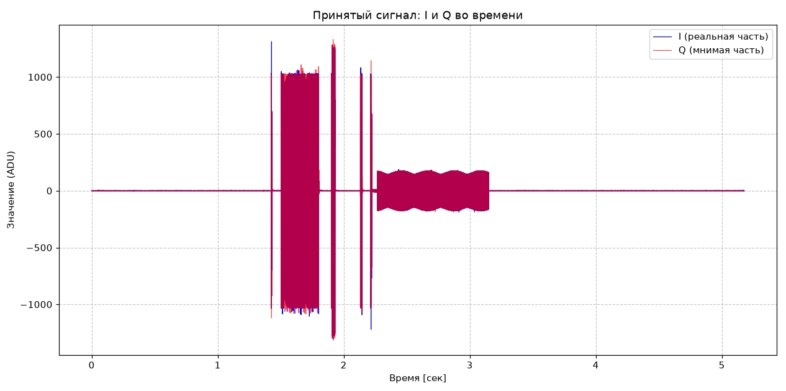
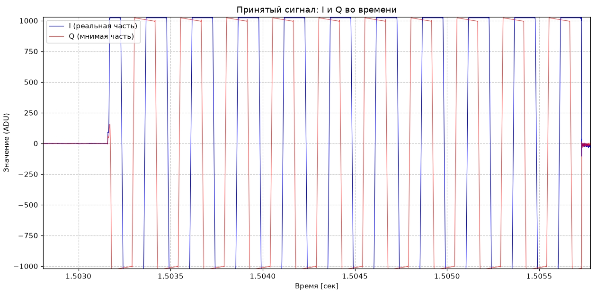
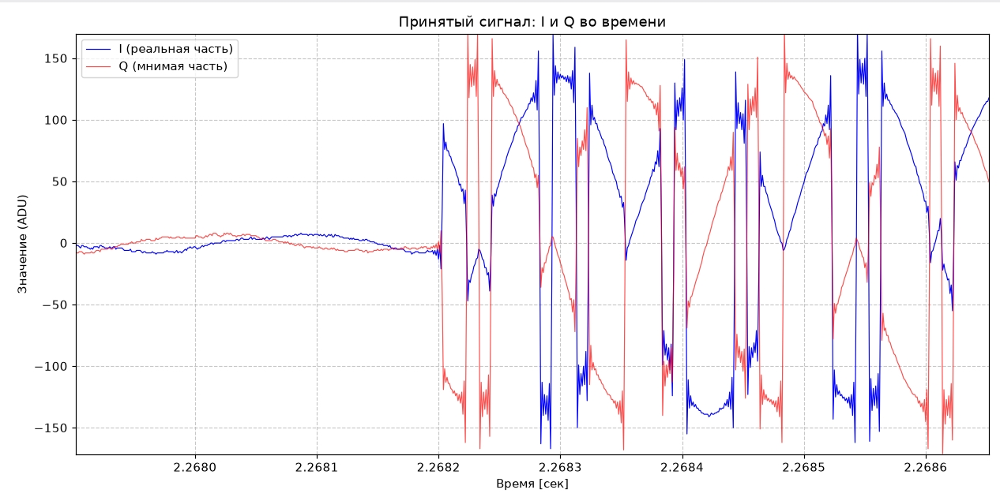
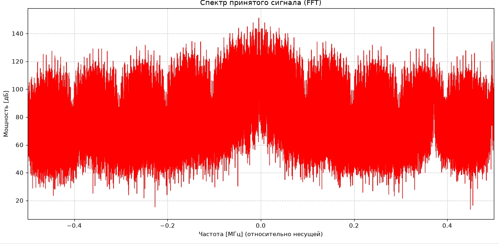
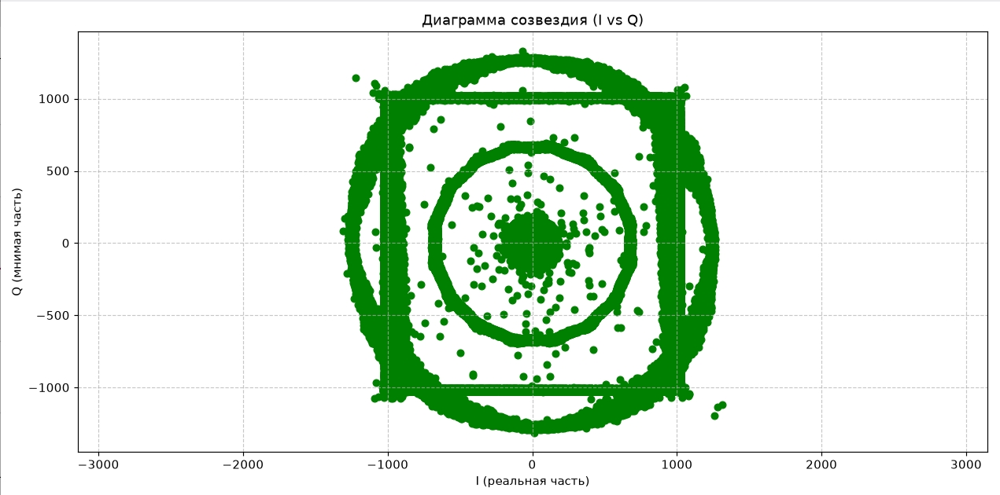

# Отчет по формированию и передачи BPSK-сигнала на базе ADALM-Pluto

**Отчётный период: неделя 7,8 (19.10 – 1.11)**

## 1. Цель работы

Реализовать передатчик, включающий генерацию битового потока(имени Самирхон в двоичном виде), его модуляцию в комплексной плоскости с использованием `BPSK`, `upsampling` - добавление нулевых отсчетов между символами, формирование прямоугольных импульсов сверткой, и создание диаграммы созвездия `I` vs `Q`.

---

## 2. BPSK-модуляция

**Binary Phase Shift Keying** — это модуляция, при котором информация передаётся с изменением фазы сигнала на 180 градусов. Каждому биту соответствует один из двух символов имеющих противоположные значения.

```cpp
Complex symbols[K];
for (int i = 0; i < K; i++)
{
symbols[i] = (bits[i] == 0)? Complex(1.0, 0.0) : Complex(-1.0, 0.0);
}
```
Таким образом, полезная составляющая сигнала находится в канале I, а составляющая Q в сигнале равна нулю.

---

## 3. Upsampling

Для формирования формы импульсов между символами добавляются нулевые отсчёты. В программе добавляем 9 символов и этим получаем кол-во отсчетов на 1 символ `SPS = 10`. 

```cpp
Complex upsampled[N_Upsampled] = {};
for (int i = 0; i < K; i++)
{
upsampled[i * SPS] = symbols[i];
}
```
---

## 4. Свертка

Заполнение нулевых отсчетов значением составляющей сигнала единицами для создания импульса.

```cpp
double h[SPS];
for (int i = 0; i < SPS; i++)
{
h[i] = 1.0;
}
```
---

## 4. Сборка и запуск

Сборка выполняется следующими командами:

```bash
cmake ../
make -j16 # nproc - количество потоков, например make -j16

./main tx   # передатчик на 840 МГц
./main rx   # приёмник на 800 МГц
```
Для повторной сборки после изменения исходного кода надо выполнить эту команду:

```bash
cmake ../
```
---

## 5. Результат

Ниже представленны полученные графики.

### 5.1 Принятый сигнал во времени.


### 5.2 Принятый сигнал (приближенный).



### 5.3 Принятый спектр.


### 5.4 Сформированное созвездие.


---

## 6. Заключение

Было реализовано формирование и передача BPSK-сигнала. Реализовано преобразование битовой последовательности в комплексные символы, upsampling, свёртка с прямоугольным импульсом.

Дополнительно реализована запись сформированных I/Q-отсчётов в файл.
